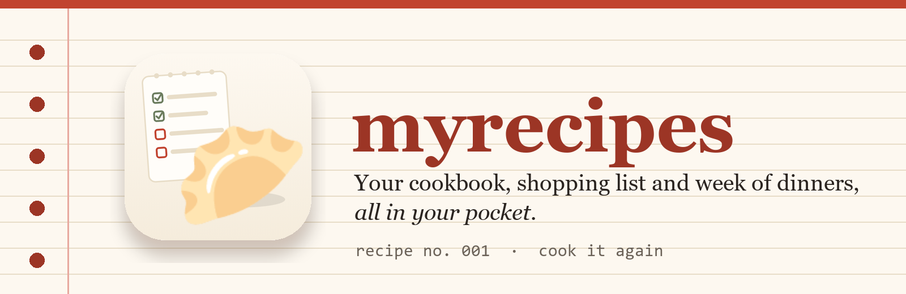
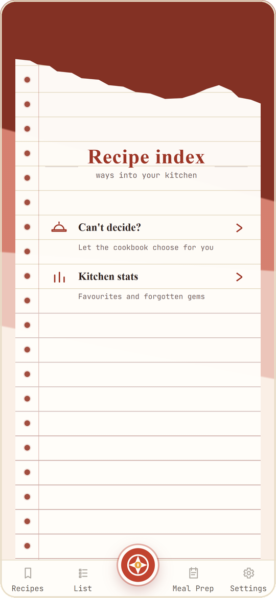
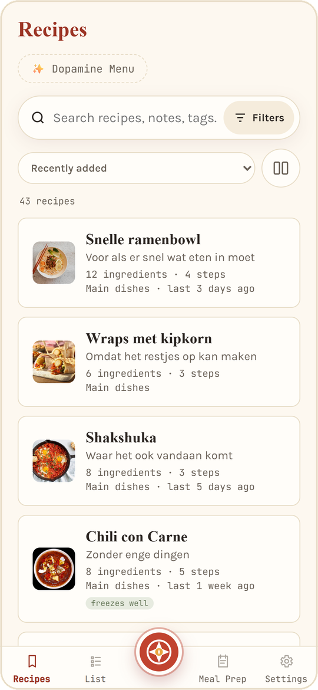
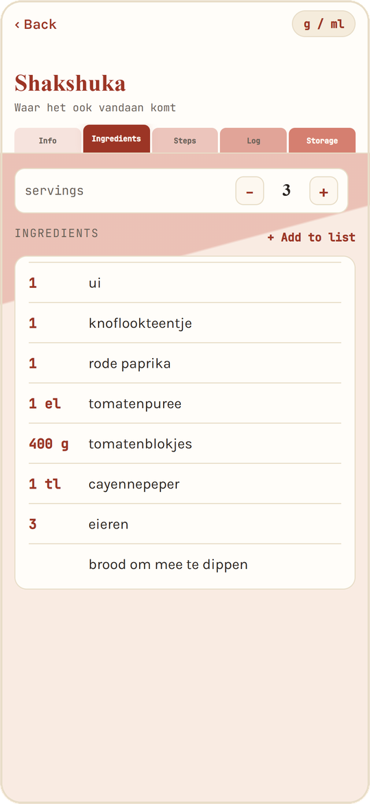
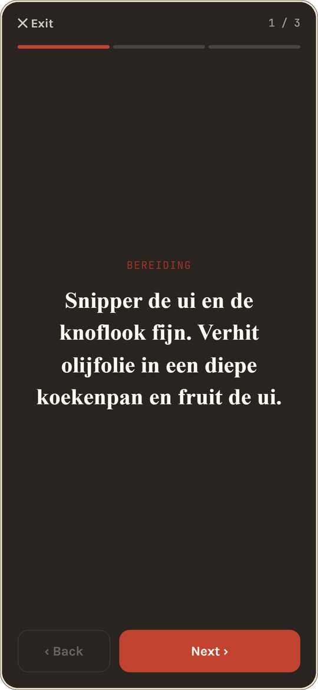
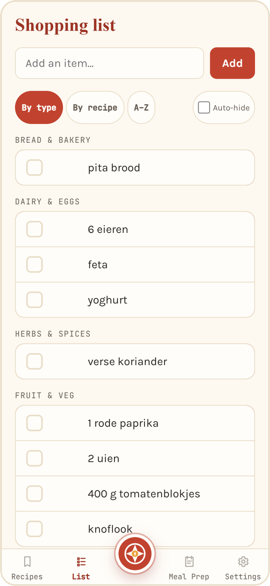

  

  
  
  

  Every recipe you love in one place, and an answer to "what are we eating tonight?" 
  Cook from your phone, fill the shopping list in one tap, and plan the week without a spreadsheet.

  
  
  
  
  

## What it does

- **Keep your cookbook**: type a recipe, paste it in one go, or import it from a website or video with a little AI help
- **Cook without the mess**: big-letter cooking mode, timers found in the steps, scaling and metric or US units
- **Shop smarter**: add a recipe's ingredients to one list, merged and sorted by supermarket aisle
- **Plan the week**: a calm week planner, with room for "eating out" and leftovers too
- **Stop deciding**: let the app pick a dinner, or open your Dopamine Menu of sure-fire favourites
- **Remember what worked**: log each cook with a thumbs up and a note, and see your favourites and forgotten gems
- **Take it with you**: installs on your phone like an app, in English or Dutch, light or dark

## Start cooking

All you need is a browser and an email address.

1. Open **[myrecipes-pi.vercel.app](https://myrecipes-pi.vercel.app/)**
2. Enter your email, tap **Send magic link**, and tap the link in your inbox
3. Tap **+** to add your first recipe

Just curious? Tap **Continue as guest** for a demo cookbook; nothing is saved. To keep the app on your phone, choose **Add to Home screen** from your browser's menu.

## Your own copy

myrecipes is open source under the [MIT licence](LICENSE). The [Setup guide](https://github.com/HoltropAF/myrecipes/wiki/Setup-guide) gets you your own version with your own database and web address, no coding needed. Want to change the code or help build it? Head to the [Developer guide](https://github.com/HoltropAF/myrecipes/wiki/Developer-guide).

## Learn more

The [wiki](https://github.com/HoltropAF/myrecipes/wiki) has the rest: [getting started and backups](https://github.com/HoltropAF/myrecipes/wiki/Using-the-app), everything the app can do in [Features](https://github.com/HoltropAF/myrecipes/wiki/Features), and [troubleshooting](https://github.com/HoltropAF/myrecipes/wiki/Troubleshooting).

Found a bug or have an idea? [Open an issue](https://github.com/HoltropAF/myrecipes/issues).

---

  Built by <a href="https://instagram.com/AnnuhFloor">@annuhfloor</a> with React, Vite, Supabase and Vercel. 🥟

